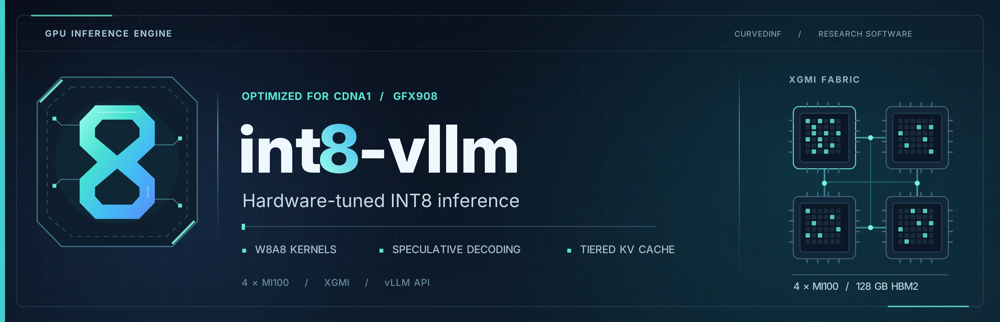

<p align="center">
  
</p>

# int8-vllm


-red)

**vLLM with opt-in INT8 acceleration for AMD Instinct MI100.**

This fork retains all mainline [vLLM](https://github.com/vllm-project/vllm)
features through backports and can run **all models supported by stock vLLM**,
subject to the same hardware and backend requirements. The normal vLLM APIs,
serving commands and model workflows remain available.

**All fork-specific INT8 features are opt-in.** Enable them through the
relevant configuration, or use a recipe launcher that selects them for you.
The recipes below are heavily optimized for four 32 GB MI100 GPUs connected
over XGMI, combining INT8 matrix kernels, INT8 KV caching and speculative
decoding to reduce memory traffic and accelerate serving.

## Optimized model recipes

This fork is compatible with all stock vLLM-supported models, but the following recipes
have been heavily optimized and tested.

| Model | Checkpoints | Concurrent sequences | Speculative tokens | Sequence Context Length | Total Context Tokens | Recipe |
| --- | --- | --- | --- | --- | --- | --- |
| Qwen3.8-27B | [INT8 PTQR target](https://huggingface.co/curvedinf/Qwen3.8-27B-GPTQ-INT8-W8A8-GS128-PTQR) + [DFlash2 draft](https://huggingface.co/curvedinf/Qwen3.8-27B-DFlash2-GPTQ-INT8-W8A8-GS128-PTQR) | 8 | 7 | 262,144 | ~1.61M | [Qwen setup](docs/recipes/README.md) |
| NVIDIA Nemotron 3.5 Bolt 74B-A9B-24GB | [Official packed target](https://huggingface.co/nvidia/NVIDIA-Nemotron-3.5-Bolt-74B-A9B-24GB) + [LiLiCorr draft](https://huggingface.co/nvidia/NVIDIA-Nemotron-3.5-Bolt-74B-A9B-24GB-LiLiCorr) | 8 | 7 | 262,144 | ~1.99M | [Bolt setup](docs/recipes/nemotron_bolt.md) |
| Flint | [INT8 PTQR target](https://huggingface.co/voodooquant/Flint-GPTQ-INT8-PTQR) + [DFlash2 draft](https://huggingface.co/voodooquant/Flint-DFlash2-GPTQ-INT8-PTQR) | 12 | 7 | 524,288 | ~4.4M | [Flint setup](docs/recipes/flint.md) |
| Tencent Hy4-flash | [NeUQI INT4 target with PTQR INT8 vision](https://huggingface.co/voodooquant/Hy4-flash-NeUQI-INT4-W4A8-GS128) + [PTQR INT8 DFly2](https://huggingface.co/voodooquant/Hy4-flash-DFly2-PTQR-INT8-W8A8-GS128) | 8 | 7 | 262,144 | ~1.34M | [HY4 setup](docs/recipes/hy4-flash.md) |

Qwen, Bolt and Flint were tested on two to four MI100s across PCIe and XGMI. HY4 supports TP4 on four 32 GiB MI100s with either XGMI or PCIe and keeps its packed Engram tables on SSD.

## Getting started

From the root of this checkout, start Qwen on four MI100 cards connected in a full XGMI mesh.

```bash
MI100_CARDS=4 MI100_XGMI=on MI100_RECIPE=qwen38 \
  docker compose -f docker/mi100/compose.yaml up --build -d
```

Choose `qwen38`, `flint`, `bolt` or `hy4`. The launcher selects the target, draft and recipe defaults. See [Docker and native installation](docs/recipes/mi100-install.md) for supported layouts, API access and overrides. For GPU visibility, topology or startup errors, see [common issues](docs/recipes/mi100-install.md#common-issues).

For a native installation managed by systemd, see [service installation and selection](docs/recipes/services.md).

## Quality control

The optimized recipes are built for fast, dependable inference. **Rigorous
quality control covers the entire serving path**, from quantized weights and
GPU kernels to complete responses and sustained concurrent workloads.
Optimizations are evaluated for model fidelity, response quality and service
stability alongside their speed and memory benefits. HY4-Flash has a dedicated
release gate covering 64 original-teacher prefixes, 52 chat checks, 114
multiple-choice questions, image and video inputs, and DFly2 decoding.
[HY4-Flash release results](https://github.com/curvedinf/int8-vllm/blob/2660cf5ec3cfc9ded4b4b26c278bbacfc7c5cf44/docs/recipes/hy4-flash.md#quality-and-memory)

- **Model fidelity:** compare 52 prompts with BF16 using KLD, output agreement and stop probability to measure quantization drift.
- **Weight integrity:** byte-check loaded/repacked weights and verify exports against the trained quantization grid to catch loading errors.
- **INT8 arithmetic:** require relative L2 error below **0.002%** for packed GEMMs and **2%** for quantized epilogues to bound numerical error.
- **Quantization and fusion:** check exact INT8 codes, **0.0002%** scale tolerance and fused-operation reference agreement to preserve calculations.
- **Attention and KV:** test masks, grouped heads, windows and page boundaries; basic reference checks limit maximum absolute error to **0.1**, or **0.05** for noncausal attention.
- **Kernel compatibility:** require **4/4** attention, GEMM and import checks so production kernels and serving interfaces work together.
- **Recurrent state:** compare updates and speculative rollback with sequential references across chunk boundaries, page boundaries and migrations to protect conversation state.
- **Multi-GPU execution:** test interleaved collectives and repeated graph replay against reference outputs to catch synchronization and replay errors.
- **Sampling correctness:** use **20,000 trials** against known probabilities, plus top-k/top-p and seeded/unseeded checks, to detect sampling bias.
- **Draft quality:** compare predictions on identical target states and track acceptance, rejection tails and long-context decay to protect speculative decoding efficiency.
- **Short answers:** require **zero detected empty or collapsed responses across 500 requests**, finite log-probabilities on 52 prompts and compliance with requested formats.
- **Long answers:** review eight **22k-input/4,096-output-token** workloads, serially and concurrently, for structural garble, repetition and progressive breakdown.
- **Token consistency:** replay exact generated tokens and measure log-probability drift, including deviations above **1 nat**, to detect inconsistent model state.
- **Mixed-load quality:** run three **32k-context/2,048-output-token** decoders alongside three fresh 32k prefills; require **zero tokens outside the reference's top 20**.
- **Cache continuity:** compare answers and token IDs after prefix reuse, RAM restoration, resets, restarts and appended prompts to verify preserved context.
- **Application behavior:** exercise arithmetic, reasoning, tools, image/video input, streaming, authentication and cross-recipe regressions to protect application compatibility.
- **Serving stability:** stress concurrent requests while checking finite activations, memory growth, allocation failures, startup/shutdown and unexpected restarts.

The [experiment ledger](docs/recipes/surface_experiments_ledger.jsonl) records individual runs. The [archived MI100 recipe notes](https://github.com/curvedinf/int8-vllm/tree/2660cf5ec3cfc9ded4b4b26c278bbacfc7c5cf44/docs/recipes) preserve the original write-ups.

## Kernels and features

The fork and companion [int8-aiter](https://github.com/curvedinf/int8-aiter)
provide these kernels and features to reduce memory traffic, accelerate
generation and reuse context. They are available beyond the standard recipes;
the second column identifies the models and architectures each path supports.

### Quantization and matrix kernels

| Kernel or feature | Applicable models |
| --- | --- |
| **AITER CK/Triton W8A8 and W8A16 GEMMs**, with tuned prefill/decode dispatch | Compatible symmetric GPTQ-8 models; W8A8 for GS128, W8A16 for other supported group sizes |
| **Fused round-to-nearest INT8 activation quantization** | Models using the fork's W8A8 linear layers |
| **INT8 embedding gathers and language-model heads** | Models using vLLM's vocabulary-parallel embedding/head layers on gfx908 |
| **Packed IQ2_XXS, Q8_0 and NVFP4 execution through GS128 INT8** | Compatible ModelOpt packed checkpoints, including Nemotron Bolt |
| **Static dense-weight and adaptive expert INT8 caches** | Packed dense/MoE models using the gfx908 ModelOpt loader |
| **Native HIP packed-expert GEMMs, route-aware prefill tiles and weighted expert reduction** | Packed IQ2_XXS MoE models, including Nemotron Bolt |
| **Shared/routed expert overlap, fused MoE norm/quantization and INT8 prefill routing** | Nemotron-H latent/shared-expert models, including Bolt |
| **GS128 INT8 residual streams, activation epilogues and draft convolutions** | Nemotron Bolt and LiLiCorr |
| **INT8 MLP intermediates with deferred reduction** | Compatible GS128 GPTQ MLP down-projections, including Qwen |

### Attention and recurrent state

| Kernel or feature | Applicable models |
| --- | --- |
| **INT8 KV cache:** per-token/head scales and grouped scales from G4 to G128 | Attention models using the fork's AITER/Triton backends |
| **Gluon MFMA G128 decode/prefill attention**, including packed, split-K and segmented variants | Compatible 256-dimensional grouped-attention heads, including Qwen3.8-27B |
| **Native INT8-MFMA QK decode/verification attention** | Qwen-style 256-dimensional heads with 6:1 grouped-query attention at TP4 |
| **Gluon split-window draft attention** | DFlash2 drafts with 128-dimensional heads and a 2,048-token sliding window |
| **Page-specialized G128 prefill attention** | Bolt-style 128-dimensional heads, 8:1 grouped-query attention and 4,256-token pages |
| **FP32-WY GDN prefill, exact scans, fused gating and tiny b/a projections** | Qwen3-Next/3.5/3.8 Gated DeltaNet hybrids |
| **Recurrent-state rollback, convolution-state handling and hybrid prefix restoration** | Supported GDN/Mamba hybrids, including Qwen and Nemotron Bolt |

### Normalization and multi-GPU communication

| Kernel or feature | Applicable models |
| --- | --- |
| **Fused residual/RMSNorm/INT8 quantization**, including a compiler fusion pass | Models using compatible RMSNorm and W8A8 layers |
| **Small-batch fused Gemma RMSNorm** | Models using Gemma-style `1 + weight` normalization, including Qwen hybrids |
| **Fused all-reduce + residual + RMSNorm + INT8 quantization** | Qwen3-Next-style decoder layers through the optional eager epilogue |
| **Custom XGMI all-reduce**, FP32 accumulation and tunable launch geometry | Tensor-parallel models on supported MI100/XGMI topologies |
| **GS32 INT8 MLP transport and GS128 INT8/deferred collectives** | TP4 MLP down-projections and the Qwen/Bolt INT8 intermediate paths |

### Speculative decoding

| Kernel or feature | Applicable models |
| --- | --- |
| **DFlash/DFlash2 and LiLiCorr speculative decoding**, including INT8 draft projections and optional INT8 convolution taps | Models with compatible draft checkpoints; Qwen3.8-27B and Nemotron Bolt |
| **Adaptive speculative-token budgets and synchronized TP sampling** | Compatible speculative target/draft pairs |

### Scheduling, caching and loading

| Kernel or feature | Applicable models |
| --- | --- |
| **Decode-priority prefill budgets, fair prefix admission and short-prefill cohorts** | All models using the V1 scheduler |
| **Early hybrid prefix checkpoints and short-prefix hashing** | Attention + recurrent-state models, including Qwen and Bolt |
| **RAM and filesystem KV tiers**, bounded disk retention and rank-local pinned buffers | Models compatible with the KV OffloadingConnector |
| **AMD Infinity Storage (AIS) integration:** load weights directly from storage into GPU memory, with per-rank repack caches and startup prefetch for faster loading | Safetensors models on AIS-capable ROCm systems, including Qwen and Nemotron Bolt |

### Runtime and tooling

| Kernel or feature | Applicable models |
| --- | --- |
| **MI100 torch.compile and graph-replay integration** | Models using vLLM's supported compilation/graph paths |
| **Chunked prompt-logprob computation** | Models exposing prompt log-probabilities through the GPU runner |
| **PTQR target/draft retraining and quantized export tools** | Qwen3.8-27B and its DFlash2 draft |
| **Thermal power control and service supervision** | All models served on the MI100 host |

## Documentation

- [INT8 coverage audit](INT8_AUDIT_RESULTS.md) — precision choices and floating-point exceptions.
- [Experiment ledger](docs/recipes/surface_experiments_ledger.jsonl) — measured changes and adoption decisions.
- [Incremental builds](docs/contributing/incremental_build.md) — development workflow.
- [License](LICENSE) — Apache 2.0.
