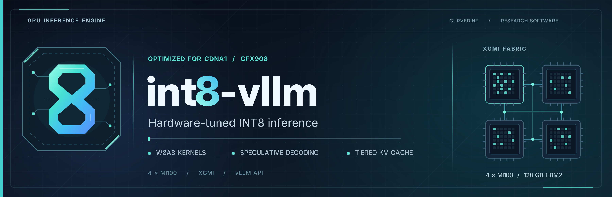

<p align="center">
  
</p>

# int8-vllm


-red)

**vLLM with opt-in INT8 acceleration for AMD Instinct MI100.**

This fork retains all mainline [vLLM](https://github.com/vllm-project/vllm)
features through backports and can run **all models supported by stock vLLM**,
subject to the same hardware and backend requirements. The normal vLLM APIs,
serving commands and model workflows remain available.

**All fork-specific INT8 features are opt-in.** Enable them through the
relevant configuration, or use a recipe launcher that selects them for you.
The recipes below are heavily optimized for four 32 GB MI100 GPUs connected
over XGMI, combining INT8 matrix kernels, INT8 KV caching and speculative
decoding to reduce memory traffic and accelerate serving.

## Supported models and optimized recipes

Stock vLLM model support extends beyond this table. These are the model pairs
with dedicated tuning and validation; each recipe uses a target model and its
matching speculative draft.

| Model | Checkpoints | Default concurrency / shared GPU context | Recipe |
| --- | --- | --- | --- |
| Qwen3.8-27B | [INT8 PTQR target](https://huggingface.co/curvedinf/Qwen3.8-27B-GPTQ-INT8-W8A8-GS128-PTQR) + [DFlash2 draft](https://huggingface.co/curvedinf/Qwen3.8-27B-DFlash2-GPTQ-INT8-W8A8-GS128-PTQR) | 6 simultaneous sequences (C6); ~1.61M shared tokens | [Qwen setup](docs/recipes/README.md) |
| NVIDIA Nemotron 3.5 Bolt 74B-A9B-24GB | [Official packed target](https://huggingface.co/nvidia/NVIDIA-Nemotron-3.5-Bolt-74B-A9B-24GB) + [LiLiCorr draft](https://huggingface.co/nvidia/NVIDIA-Nemotron-3.5-Bolt-74B-A9B-24GB-LiLiCorr) | 8 simultaneous sequences (C8); ~1.99M shared tokens | [Bolt setup](docs/recipes/nemotron_bolt.md) |
| Flint | PTQR INT8 target + draft (built from [flint](https://huggingface.co/RecursiveSI/flint) + [Flint-DFlash2](https://huggingface.co/incoai/Flint-DFlash2); see recipe) | 12 simultaneous sequences (C12); ~4.4M shared tokens, 512k per-request cap | [Flint setup](docs/recipes/flint.md) |

Qwen uses INT8 weights retrained against a BF16 reference. Bolt loads the
official packed checkpoints, converts dense weights to INT8 and caches INT8
expert weights. Flint ships PTQR INT8 weights for target and draft, runs
AITER W8A8 dense GEMMs plus a grouped W8A8 expert kernel, and keeps INT8 KV
on both models. All recipes use grouped INT8 KV for the target and draft,
AITER attention kernels and custom XGMI all-reduce.

These recipes are tested on **4 × MI100 (gfx908), with XGMI full mesh**.
Model-specific precision choices, validation results and limitations are
documented in the linked recipes.

## Getting started

Use the setup below to run one of the optimized recipes on four MI100 GPUs.

### 1. Prepare the environment

Use Linux with ROCm at `/opt/rocm`, a repository-local `.venv` and a sibling
[int8-aiter](https://github.com/curvedinf/int8-aiter) checkout:

```bash
cd "$HOME"
git clone --branch main https://github.com/curvedinf/int8-vllm.git
git clone --branch main https://github.com/curvedinf/int8-aiter.git aiter
cd int8-vllm
```

The tested serving environment uses **Python 3.12, PyTorch 2.11.0+rocm7.1
and Triton 3.6.0**, with patched **HIP/HSA 7.2.53211** runtime libraries.
Follow the [runtime setup](docs/recipes/README.md#the-stack) before building:
the original ROCm 7.1 runtime leaks host memory during graph replay.
Keep AITER on `PYTHONPATH` from the sibling checkout; do not pip-install it
into the serving environment.

### 2. Build and validate

After provisioning the serving environment:

```bash
export ROCM_PATH=/opt/rocm HIP_PATH=/opt/rocm
export PYTORCH_ROCM_ARCH=gfx908 GPU_ARCHS=gfx908 VLLM_TARGET_DEVICE=rocm
export LD_LIBRARY_PATH="/opt/rocm/lib:${LD_LIBRARY_PATH:-}"
export PATH="$PWD/.venv/bin:/opt/rocm/bin:$PATH"
export PYTHONPATH="$PWD:$PWD/../aiter"
MAX_JOBS=32 .venv/bin/python setup.py build_ext --inplace

# Required by Bolt's default INT8 decoder path.
scripts/build_residual_g128.sh

# Run on idle GPUs before serving.
.venv/bin/python scripts/test_int8_kv_micro.py
HIP_VISIBLE_DEVICES=0 .venv/bin/python scripts/battery_gfx908.py
```

The battery should report **4/4 PASS**. Allow time for AITER's first-use
kernel compilation.

### 3. Download models and start a recipe

Download the target and matching draft linked above. Use the default model
directories in the chosen recipe, or set `MODEL_DIR` and `DRAFT_MODEL_DIR`.
Provide your API key through `VLLM_API_KEY` before starting.

Choose one recipe:

```bash
# Qwen3.8-27B + DFlash2
scripts/serve_recipe_qwen38.sh start
```

```bash
# Nemotron 3.5 Bolt + LiLiCorr
scripts/serve_recipe_bolt.sh start
```

Both launchers default to **127.0.0.1:8020**, so run one at a time.
Use `status`, `stop` or `restart` in place of `start` to manage the server.
The API model names are `qwen3.8-27b-gptq8` and `nemotron-bolt`;
logs are in `logs/serve_recipe_qwen38/` and `logs/serve_recipe_bolt/`.
For persistent deployment, see [systemd setup](docs/recipes/services.md).

## Quality control

The optimized recipes are built for fast, dependable inference. **Rigorous
quality control covers the entire serving path**, from quantized weights and
GPU kernels to complete responses and sustained concurrent workloads.
Optimizations are evaluated for model fidelity, response quality and service
stability alongside their speed and memory benefits.

- **Model fidelity:** compare 52 prompts with BF16 using KLD, output agreement and stop probability to measure quantization drift.
- **Weight integrity:** byte-check loaded/repacked weights and verify exports against the trained quantization grid to catch loading errors.
- **INT8 arithmetic:** require relative L2 error below **0.002%** for packed GEMMs and **2%** for quantized epilogues to bound numerical error.
- **Quantization and fusion:** check exact INT8 codes, **0.0002%** scale tolerance and fused-operation reference agreement to preserve calculations.
- **Attention and KV:** test masks, grouped heads, windows and page boundaries; basic reference checks limit maximum absolute error to **0.1**, or **0.05** for noncausal attention.
- **Kernel compatibility:** require **4/4** attention, GEMM and import checks so production kernels and serving interfaces work together.
- **Recurrent state:** compare updates and speculative rollback with sequential references across chunk boundaries, page boundaries and migrations to protect conversation state.
- **Multi-GPU execution:** test interleaved collectives and repeated graph replay against reference outputs to catch synchronization and replay errors.
- **Sampling correctness:** use **20,000 trials** against known probabilities, plus top-k/top-p and seeded/unseeded checks, to detect sampling bias.
- **Draft quality:** compare predictions on identical target states and track acceptance, rejection tails and long-context decay to protect speculative decoding efficiency.
- **Short answers:** require **zero detected empty or collapsed responses across 500 requests**, finite log-probabilities on 52 prompts and compliance with requested formats.
- **Long answers:** review eight **22k-input/4,096-output-token** workloads, serially and concurrently, for structural garble, repetition and progressive breakdown.
- **Token consistency:** replay exact generated tokens and measure log-probability drift, including deviations above **1 nat**, to detect inconsistent model state.
- **Mixed-load quality:** run three **32k-context/2,048-output-token** decoders alongside three fresh 32k prefills; require **zero tokens outside the reference's top 20**.
- **Cache continuity:** compare answers and token IDs after prefix reuse, RAM restoration, resets, restarts and appended prompts to verify preserved context.
- **Application behavior:** exercise arithmetic, reasoning, tools, image/video input, streaming, authentication and cross-recipe regressions to protect application compatibility.
- **Serving stability:** stress concurrent requests while checking finite activations, memory growth, allocation failures, startup/shutdown and unexpected restarts.

See the [recipe guides](docs/recipes/README.md) for configuration and validation details.

## Kernels and features

The fork and companion [int8-aiter](https://github.com/curvedinf/int8-aiter)
provide these kernels and features to reduce memory traffic, accelerate
generation and reuse context. They are available beyond the standard recipes;
the second column identifies the models and architectures each path supports.

### Quantization and matrix kernels

| Kernel or feature | Applicable models |
| --- | --- |
| **AITER CK/Triton W8A8 and W8A16 GEMMs**, with tuned prefill/decode dispatch | Compatible symmetric GPTQ-8 models; W8A8 for GS128, W8A16 for other supported group sizes |
| **Fused round-to-nearest INT8 activation quantization** | Models using the fork's W8A8 linear layers |
| **INT8 embedding gathers and language-model heads** | Models using vLLM's vocabulary-parallel embedding/head layers on gfx908 |
| **Packed IQ2_XXS, Q8_0 and NVFP4 execution through GS128 INT8** | Compatible ModelOpt packed checkpoints, including Nemotron Bolt |
| **Static dense-weight and adaptive expert INT8 caches** | Packed dense/MoE models using the gfx908 ModelOpt loader |
| **Native HIP packed-expert GEMMs, route-aware prefill tiles and weighted expert reduction** | Packed IQ2_XXS MoE models, including Nemotron Bolt |
| **Shared/routed expert overlap, fused MoE norm/quantization and INT8 prefill routing** | Nemotron-H latent/shared-expert models, including Bolt |
| **GS128 INT8 residual streams, activation epilogues and draft convolutions** | Nemotron Bolt and LiLiCorr |
| **INT8 MLP intermediates with deferred reduction** | Compatible GS128 GPTQ MLP down-projections, including Qwen |

### Attention and recurrent state

| Kernel or feature | Applicable models |
| --- | --- |
| **INT8 KV cache:** per-token/head scales and grouped scales from G4 to G128 | Attention models using the fork's AITER/Triton backends |
| **Gluon MFMA G128 decode/prefill attention**, including packed, split-K and segmented variants | Compatible 256-dimensional grouped-attention heads, including Qwen3.8-27B |
| **Native INT8-MFMA QK decode/verification attention** | Qwen-style 256-dimensional heads with 6:1 grouped-query attention at TP4 |
| **Gluon split-window draft attention** | DFlash2 drafts with 128-dimensional heads and a 2,048-token sliding window |
| **Page-specialized G128 prefill attention** | Bolt-style 128-dimensional heads, 8:1 grouped-query attention and 4,256-token pages |
| **FP32-WY GDN prefill, exact scans, fused gating and tiny b/a projections** | Qwen3-Next/3.5/3.8 Gated DeltaNet hybrids |
| **Recurrent-state rollback, convolution-state handling and hybrid prefix restoration** | Supported GDN/Mamba hybrids, including Qwen and Nemotron Bolt |

### Normalization and multi-GPU communication

| Kernel or feature | Applicable models |
| --- | --- |
| **Fused residual/RMSNorm/INT8 quantization**, including a compiler fusion pass | Models using compatible RMSNorm and W8A8 layers |
| **Small-batch fused Gemma RMSNorm** | Models using Gemma-style `1 + weight` normalization, including Qwen hybrids |
| **Fused all-reduce + residual + RMSNorm + INT8 quantization** | Qwen3-Next-style decoder layers through the optional eager epilogue |
| **Custom XGMI all-reduce**, FP32 accumulation and tunable launch geometry | Tensor-parallel models on supported MI100/XGMI topologies |
| **GS32 INT8 MLP transport and GS128 INT8/deferred collectives** | TP4 MLP down-projections and the Qwen/Bolt INT8 intermediate paths |

### Speculative decoding

| Kernel or feature | Applicable models |
| --- | --- |
| **DFlash/DFlash2 and LiLiCorr speculative decoding**, including INT8 draft projections and optional INT8 convolution taps | Models with compatible draft checkpoints; Qwen3.8-27B and Nemotron Bolt |
| **Adaptive speculative-token budgets and synchronized TP sampling** | Compatible speculative target/draft pairs |

### Scheduling, caching and loading

| Kernel or feature | Applicable models |
| --- | --- |
| **Decode-priority prefill budgets, fair prefix admission and short-prefill cohorts** | All models using the V1 scheduler |
| **Early hybrid prefix checkpoints and short-prefix hashing** | Attention + recurrent-state models, including Qwen and Bolt |
| **RAM and filesystem KV tiers**, bounded disk retention and rank-local pinned buffers | Models compatible with the KV OffloadingConnector |
| **AMD Infinity Storage (AIS) integration:** load weights directly from storage into GPU memory, with per-rank repack caches and startup prefetch for faster loading | Safetensors models on AIS-capable ROCm systems, including Qwen and Nemotron Bolt |

### Runtime and tooling

| Kernel or feature | Applicable models |
| --- | --- |
| **MI100 torch.compile and graph-replay integration** | Models using vLLM's supported compilation/graph paths |
| **Chunked prompt-logprob computation** | Models exposing prompt log-probabilities through the GPU runner |
| **PTQR target/draft retraining and quantized export tools** | Qwen3.8-27B and its DFlash2 draft |
| **Thermal power control and service supervision** | All models served on the MI100 host |

## Documentation

- [Qwen recipe](docs/recipes/README.md) and [Bolt recipe](docs/recipes/nemotron_bolt.md) — configuration, benchmarks and validation.
- [INT8 coverage audit](INT8_AUDIT_RESULTS.md) — precision choices and floating-point exceptions.
- [Experiment ledger](docs/recipes/surface_experiments_ledger.jsonl) — measured changes and adoption decisions.
- [Incremental builds](docs/contributing/incremental_build.md) — development workflow.
- [License](LICENSE) — Apache 2.0.
